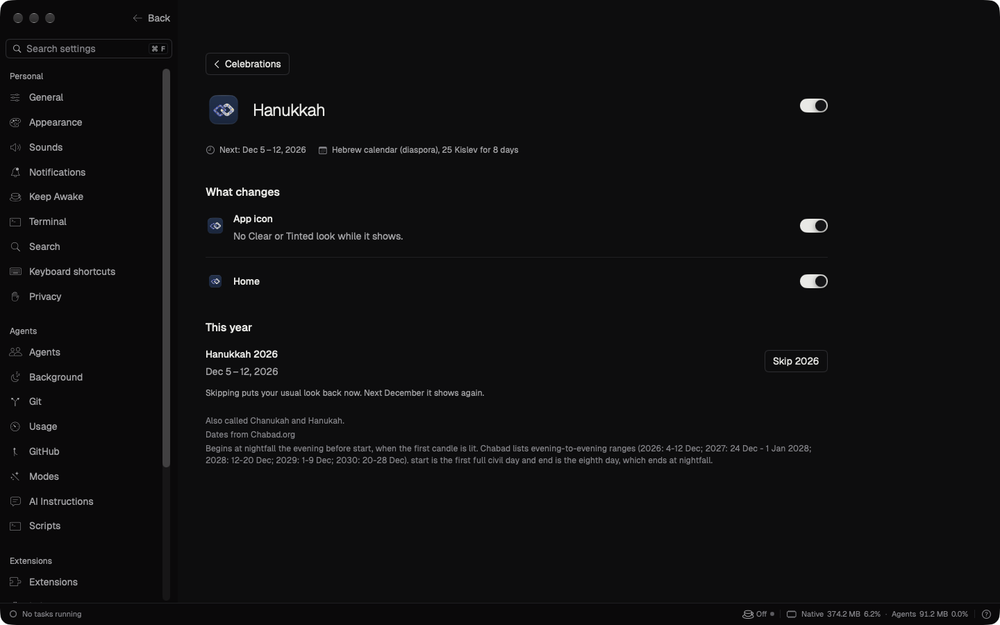

# Celebration settings visual check

Revision: fb30a626cb91bb6a8c5957b8d2656c72454484a1. Isolated Debug instance vc-104, 1440 by 900 points.

All preview captures use inert fixtures. The current Settings primitives intentionally differ from the Plainly styling in the mock. Catalogue counts follow real data.

## Blocking finding

From the page, choose December in the year strip, open Hanukkah, then use Back to Celebrations or Cmd-[. The catalogue returns to its top instead of December. Reproduced twice on the unchanged PR revision. The main scrollbar changes from 0.4275395 to 0.

| Before opening details | Detail | After Back |
| --- | --- | --- |
|  |  |  |

## Preview states

| State | Dark | Light |
| --- | --- | --- |
| page |  |  |
| showing |  |  |
| homeOnly |  |  |
| skipped |  |  |
| waiting |  |  |
| failed |  |  |
| empty |  |  |
| yearHover |  |  |
| rows |  |  |
| overlaps |  |  |
| detail |  |  |
| style |  |  |
| offline |  |  |
| confirmation |  |  |
| off |  |  |
| pending |  |  |
| menu |  |  |
| search |  |  |
| noMatches |  |  |
| unavailableSelections |  |  |
| unavailableDetail |  |  |

The menu preview starts at its trigger. The pending preview initially shows the catalogue; unavailable rows are visible in the rows and unavailable-selection previews.
