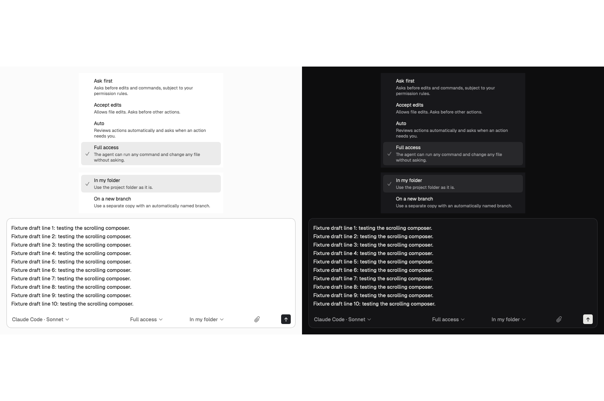

# Composer live-test fixes at 662638f7

Visual check pending

Status: fixes committed; automated input checks and real view rendering pass. Both requested full-app live checks remain blocked and must be rerun before merge. This is not a live-pass report.

The Mode and Where popover containers applied their names to every descendant button. Removing those container labels preserves each existing option's visible accessibility label and selected value. No styling changed.

The macOS text input measured proposed widths by changing the live text container and editor frame, including widths SwiftUI never placed. A rejected-width probe reproduced that mutation before the fix. Measurement now uses a separate TextKit layout; the live editor changes size only during placement. The rejected-width regression fails before and passes after. The exact reported full-app AX stall and overlapping draft were not reproduced in this run, so that symptom still needs the live retest.

## Verification

- `scripts/dev/run-isolated.sh cx-fix273 --build`: passed against these product sources after merging origin/main at 8d548cd2.
- `scripts/check-warnings.sh /tmp/native-dd/cx-fix273/build.log`: no repository warnings.
- `scripts/tests/composer-field-input.sh cx-fix273`: passed. Includes native edits and undo/redo, twenty-line unsent draft, nonoverlapping line fragments, full editor content height, capped scrolling, rejected-width measurement, attachments, completions, queue editing, and question/approval focus routing.
- Strict Swift formatting lint on the four changed Swift files, shell syntax, and `git diff --check`: passed.
- Real SwiftUI preview rendered with `scripts/dev/render-previews.py`, using the built Debug module. The image below contains both light and dark appearances. Normal line spacing and the ten-line scrolling cap are visible. No mock UI was substituted.
- `scripts/tests/composer-menu-accessibility.sh cx-fix273`: BLOCKED (exit 2). This new pid-scoped live regression checks all six visible choice names and exactly one selected value in each menu. It requires an accessible unsent task with a project and all choices available.
- Full-app twenty-line draft check: BLOCKED. The app window renders, but the window accessibility requests resolve to the application element; the tree contains no controls and focus reports the application. No keyboard events were sent without confirmed text-field focus. The screen was unlocked. The isolated instance was muted and quit after the check.

The second appearance pass of the preview renderer collapsed its content. It is excluded from the evidence. The first pass contains the complete paired light and dark views shown here.

## Changed states and matching references

| State | Screenshot | Matching reference |
| --- | --- | --- |
| Mode: Ask first, Accept edits, Auto, Full access; Full access selected | `menus-and-long-draft-light-dark.png`, top pair | Existing mode previews and supplied live captures `62-mode-options-dark.png` / `67-mode-options-light.png` |
| Where: In my folder, On a new branch; In my folder selected | Same image, middle pair | Existing Where previews and supplied live captures `57-where-options-dark.png` / `68-where-options-light.png` |
| Twenty-line unsent draft at ten-line scrolling cap | Same image, bottom pair | Existing ComposerField preview and composer specification; supplied failure capture `64-long-typed-draft-settled-light.png` |

No exact mock images were supplied for these fixes. The [existing composer specification and reference report](../spec-bbbcd1b7a/visual-report.md) and [original live test](https://github.com/binbandit/native/pull/273#issuecomment-6602844209) remain the comparison sources. The paired image was visually inspected for spacing, wrapping, selection treatment and line overlap. Coordinator design approval is still required.

## Files added and removed

Added `scripts/tests/composer-menu-accessibility.sh`: checks actual popover names and selected values through the isolated instance's accessibility driver. No files removed. Existing files changed: the two menu views, the macOS text input adapter, the existing input regression harness, and the architecture explanation.

## Separate follow-up note

Title: Answered questions look unanswered after reopening the transcript.

Steps: receive a question with Alpha/Beta choices, answer Alpha, let the response finish, then reopen the transcript. Expected: the question is visibly answered. Actual in the supplied live test: it says "Waiting for your answer" although the later Alpha answer is present and no question card is pending. Observed once in the supplied live test; not independently retested here. Evidence: original live capture `48-mode-labels-light.png` and its accessibility tree. This belongs to transcript/history follow-up; no additional PR or source change was made.
